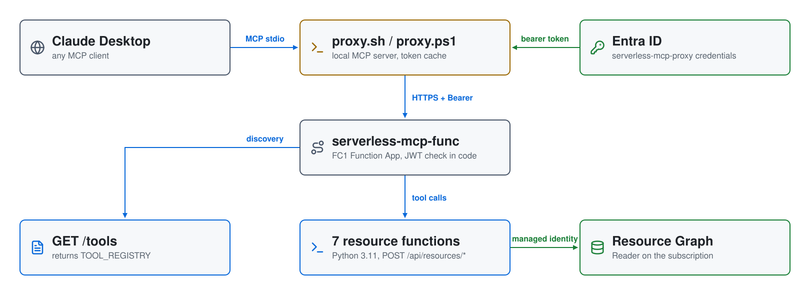

# Serverless MCP on Azure: Resource Graph Tools

A **serverless MCP (Model Context Protocol) backend** that lets an AI
assistant ask about your Azure resources in plain English. A **Flex
Consumption Function App** serves seven resource tools and a tool registry,
each an HTTP function that checks an **Entra ID** bearer token before it
runs. A small local proxy speaks MCP over stdio to the AI client, gets and
caches the token, and forwards each call, so the remote API looks like a
local tool server.

| Piece | Where | Role |
|---|---|---|
| **proxy.sh** / **proxy.ps1** | your machine | stdio MCP server (JSON-RPC 2.0); client-credentials token from Entra ID, refreshed 60 s before expiry; loads its tool list from `GET /tools` |
| **serverless-mcp-func-&lt;hex&gt;** | `serverless-mcp-rg`, Central US | Function App on the `FC1` Flex Consumption plan, Python 3.11, up to 10 instances of 2 GB; eight HTTP functions in `function_app.py` |
| **serverless-mcp-api** | Entra ID | app registration whose client ID is the token audience |
| **serverless-mcp-proxy** | Entra ID | app registration and service principal the proxy signs in as; its secret expires in 2099 |
| **Managed identity** | Function App | system-assigned, with `Reader` on the subscription, used to query Resource Graph |
| **Storage + Application Insights** | `serverless-mcp-rg` | `serverlessmcp<hex>` holds the deployment package; `serverless-mcp-ai` collects telemetry and the audit log |

## Architecture

<picture>
  <source media="(prefers-color-scheme: dark)" srcset="architecture-dark.svg">
  
</picture>

Regenerate with `python3 make_diagram.py`.

- **`01-functions/`**: `main.tf` (providers, resource group), `entra.tf` (the
  two app registrations and the proxy secret), `functions.tf` (storage,
  plan, Application Insights, Function App), `rbac.tf` (the `Reader`
  assignment), and the code in `code/function_app.py`.
- **`02-proxy/`**: the Bash and PowerShell proxies.

## How a call is authorized

The `FC1` plan doesn't support App Service Authentication (Easy Auth), so
every function validates the token itself before doing anything:

1. It reads the `Authorization: Bearer` header and finds the token's signing
   key in Entra ID's JWKS for the tenant (cached while the instance is warm).
2. PyJWT checks the RS256 signature, that the audience is the
   `serverless-mcp-api` client ID, and the expiry. Any failure returns `401`.
3. It logs `AUDIT tool=<tool> caller=<x-mcp-user>`; the proxy sends your
   local user name in `x-mcp-user`.

The token isn't checked for a role or for the calling app, so any service
principal in the tenant that can get a token for `serverless-mcp-api` can
call the API.

## MCP tools

All routes are under `/api` and take a JSON body; the reply is plain text,
so the AI can read it out directly.

| Tool | Route | Input | Returns |
|---|---|---|---|
| `list_virtual_machines` | `POST /resources/virtual-machines` | none | every VM with size, resource group and location |
| `list_resource_groups` | `POST /resources/resource-groups` | none | every resource group with location and tag count |
| `count_resources_by_type` | `POST /resources/count-by-type` | none | resource types ranked by count |
| `find_resources_by_tag` | `POST /resources/by-tag` | `tag_key`, `tag_value` | resources with that tag |
| `list_public_ip_addresses` | `POST /resources/public-ips` | none | public IPs with allocation method |
| `find_resources_by_resource_group` | `POST /resources/by-resource-group` | `resource_group` | resources in that group |
| `find_resources_by_region` | `POST /resources/by-region` | `region` | resources in that region |

Each one runs a KQL query against Resource Graph, scoped to the
subscription. Inputs are escaped before they go into the query, and a
missing required input returns `400`. For example:

```
Resources by type (11 total):

      5  microsoft.network/networkwatchers
      2  microsoft.operationalinsights/workspaces
      1  microsoft.web/sites
      1  microsoft.keyvault/vaults
      1  microsoft.storage/storageaccounts
      1  microsoft.insights/components
```

### How the proxy configures itself

At startup the proxy calls `GET /api/tools` and gets `TOOL_REGISTRY`:

```json
[
  {
    "name": "list_virtual_machines",
    "description": "Lists all virtual machines in the subscription with name, resource group, location, and VM size.",
    "inputSchema": { "type": "object", "properties": {}, "required": [] },
    "route": "/resources/virtual-machines"
  }
]
```

It keeps `route` for itself and hands the AI the standard MCP fields. To add
a tool, add it to `function_app.py` and redeploy; the proxy picks it up on
its next start. Because the proxy has no tool-specific code, it can front any
backend that serves `GET /tools` in this format.

## Prerequisites

* [An Azure Account](https://portal.azure.com/)
* [Install AZ CLI](https://learn.microsoft.com/en-us/cli/azure/install-azure-cli)
* [Install Terraform](https://developer.hashicorp.com/terraform/install)
* `jq` and `zip` (for `apply.sh`)
* `bash` 4+ and `curl` (for `proxy.sh`), or PowerShell (for `proxy.ps1`)
* An MCP client: Claude Desktop, or any host that supports stdio servers

`check_env.sh` expects a service principal in `ARM_CLIENT_ID`,
`ARM_CLIENT_SECRET`, `ARM_SUBSCRIPTION_ID` and `ARM_TENANT_ID`. It needs
rights to create app registrations in Entra ID and to assign `Reader` on the
subscription. If this is your first time following along, we recommend
starting with this video:
[Azure + Terraform: Easy Setup](https://youtu.be/wwi3kVgYNOk).

## Deploy

```bash
git clone https://github.com/mamonaco1973/azure-serverless-mcp.git
cd azure-serverless-mcp
./apply.sh
```

`apply.sh` applies `01-functions`, zips `01-functions/code` and deploys it
with `az functionapp deployment source config-zip --build-remote true`, then
writes `02-proxy/claude_desktop_config_ps1.json` and
`claude_desktop_config_sh.json` (both gitignored) from the Terraform outputs,
including the proxy's client secret. It ends by running `validate.sh`, which
gets a token the same way the proxy does and calls all eight routes:

```
NOTE: Validating all endpoints...

NOTE: OK  GET /tools
       list_virtual_machines             /resources/virtual-machines
       ...
NOTE: OK  POST /resources/by-region
       Resources in centralus (8 total):
       ...

========================================================================
  Validation complete — all 8 endpoints returned HTTP 200.
========================================================================
```

## Try it

1. Copy the `mcpServers` block from `02-proxy/claude_desktop_config_sh.json`
   (Bash) or `claude_desktop_config_ps1.json` (PowerShell) into your Claude
   Desktop `claude_desktop_config.json`, and replace
   `REPLACE_WITH_ABSOLUTE_PATH` with where you cloned the repository.
2. Restart Claude Desktop and ask, for example, "Which resource groups do I
   have?" or "List everything in centralus."
3. Call a route without a token and you get `401 Unauthorized`:

   ```bash
   curl -i -X POST https://serverless-mcp-func-<hex>.azurewebsites.net/api/resources/resource-groups
   ```

## Teardown

```bash
./destroy.sh
```

## Notes

- **Lab only.** The proxy's client secret is in the Terraform state and in
  the generated config files on your machine; keep those private.
- `02-proxy/claude_desktop_config_{sh,ps1}.json.tmpl` aren't used:
  `apply.sh` builds the configs with `jq`. The templates name the server
  `azure-cost-mcp`; the generated configs use `azure-resource-mcp`.
- `webapp.png` in this repository shows a different project (a notes demo)
  and isn't used here.
